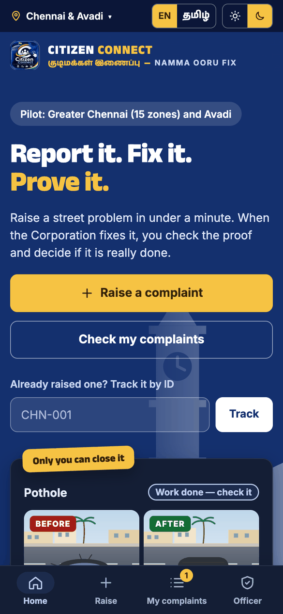
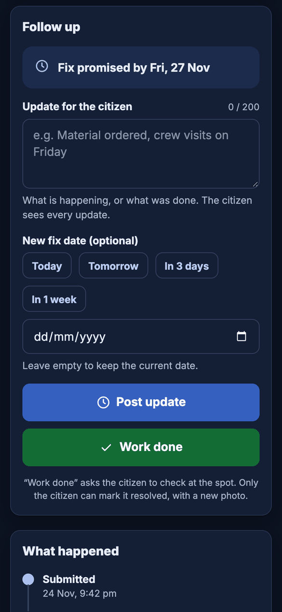
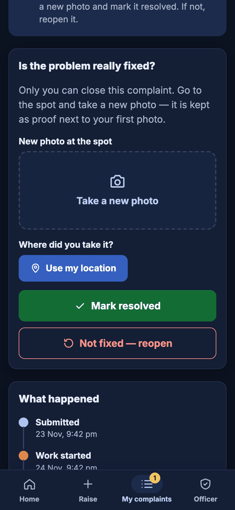
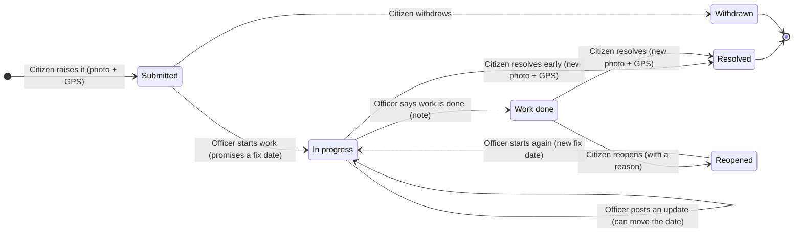

# Citizen Connect — Namma Ooru Fix

A civic-complaint web app for Greater Chennai and Avadi with **proof of fix**.

Most complaint systems let the department close a complaint by itself. In Citizen Connect:

1. A citizen raises a street problem with a **photo** and a **GPS location**.
2. The officer **follows up**: promises a **fix date**, posts updates the citizen can see, and says when the work is done.
3. **Only the citizen** can close it, by going to the spot and taking a **new photo**, which is kept next to the first one. If it isn't really fixed, they reopen it with a reason.

Plain HTML, CSS and JavaScript, with no framework and no build step. It works in English and Tamil, in light and dark themes, installs on a phone as an app (PWA), and works offline after the first visit.

> Student prototype by Class XII, Gandhiji Matriculation School, Avadi — Inter-School Hackathon 2026.
> Not an official Greater Chennai Corporation app.

**Live app:** <https://sjaishree0502.github.io/citizen-connect/> (after GitHub Pages is switched on — see [Put it online](#put-it-online-and-install-it)) · **Code:** <https://github.com/sjaishree0502/citizen-connect>

<table>
  <tr>
    <td align="center"><br><sub>Home</sub></td>
    <td align="center"><br><sub>Raise a complaint</sub></td>
    <td align="center"><br><sub>Officer: follow up</sub></td>
    <td align="center"><br><sub>Citizen: check &amp; resolve</sub></td>
  </tr>
</table>

---

## Contents

- [Features](#features)
- [The complaint loop](#the-complaint-loop)
- [Tech stack](#tech-stack)
- [Run it on your computer](#run-it-on-your-computer)
- [Tests](#tests)
- [Put it online and install it](#put-it-online-and-install-it)
- [Demo mode and cities](#demo-mode-and-cities)
- [Hackathon demo script](#hackathon-demo-script)
- [Folder map](#folder-map)
- [Data, storage and photos](#data-storage-and-photos)
- [Security and privacy](#security-and-privacy)
- [Limits and next steps](#limits-and-next-steps)

---

## Features

| Feature | What it does | Why |
|---|---|---|
| **Only the citizen closes** | The officer can only say "Work done"; the citizen marks it Resolved | The person who reported it decides |
| **Photo + GPS on every complaint** | 14 problem types; location must be inside Greater Chennai or Avadi | The ward team can find the exact spot |
| **Promised fix date + Overdue** | The officer must pick a date to start work; both sides see "Overdue" if it passes | Makes the officer accountable |
| **Officer updates** | Every update (and date change) appears on the citizen's timeline | The citizen is never left guessing |
| **Proof of fix** | New photo at the spot, newer than "Work done", with GPS (±150 m) | Old gallery photos can't fake a fix |
| **Before / after slider** | First photo and resolution photo side by side | Proof you can see in one second |
| **Reopen with a reason** | "Not fixed — reopen" sends it back; reopened ones are listed first | The officer knows what is still wrong |
| **Fixed on time / late** | Compares "Work done" with the promised date | A fair record for good officers |
| **Duplicate warning** | Warns if the same problem was reported within 50 m | Avoids repeat complaints |
| **Two cities** | Switch between Greater Chennai (15 zones) and Avadi | Each city sees its own complaints |
| **English + தமிழ், light / dark** | One-tap switches; phone menu (☰) | Usable by everyone, day or night |
| **Installable, works offline** | PWA: add to home screen; opens without internet | No app store; weak networks are fine |
| **Demo mode** | Sample complaints, demo photos and location, demo officer — clearly labelled | Present indoors without a camera or GPS |

---

## The complaint loop



Every change goes through one file, [`js/rules.js`](js/rules.js), which decides **who** may make it and **what proof** it needs. Anything not listed there is refused. (In the code, "Work done" is the status `Fixed` and "Resolved" is `Verified`.)

| Status | Citizen sees | Officer sees |
|---|---|---|
| Submitted | "Waiting for an officer to start work" | **Start work**: must choose the date the fix will be done by |
| In progress | "Fix promised by Thu, 27 Nov" (red **Overdue** if it passed) and every officer update; can resolve early with a new photo | **Follow up**: post an update (optionally with a new date) or tap **Work done** |
| Work done | **Check & resolve**: take a new photo at the spot and **Mark resolved**, or **Not fixed — reopen** | "Waiting for the citizen" |
| Reopened | "Waiting for the officer to start again" | Listed first, with the citizen's reason |
| Resolved / Withdrawn | Closed, with "Fixed on time" or "late" | Closed |

### What the citizen must provide to resolve a complaint

| Proof | Checked by |
|---|---|
| A new photo | `rules.js` refuses "Resolved" without one |
| Taken **after** the officer said the work is done (or after the complaint was raised / last reopened) | The camera's EXIF date, or the file's time, is read before the photo is re-encoded. Older photos are refused. |
| GPS location where it was taken | Must be inside Greater Chennai or Avadi, with accuracy of ±150 m or better. The distance from the first pin is shown. |

The officer never uploads photos and can never close a complaint.

---

## Tech stack

| Part | Technology | Why |
|---|---|---|
| Screens | HTML, CSS, JavaScript (ES modules) — **no framework, no build step** | Fast on cheap phones; everyone in the team can read it |
| Complaints | `localStorage` in the browser (~1 KB each) | Free, works offline, no server needed for the prototype |
| Photos | IndexedDB (browser database) | Holds photos too big for localStorage |
| Photo shrinking + privacy | Canvas → 1200 px JPEG (7 MB → ~45–200 KB), re-encoding removes hidden GPS (EXIF) | Small and private |
| Photo date check | Reads the EXIF "date taken" (or file time) before shrinking | Blocks old photos |
| Location | Geolocation API (GPS + accuracy in metres) | Proves where the photo was taken |
| Offline + install | Service Worker (network-first) + Web App Manifest (PWA) | One code for Android, iPhone and PC |
| Officer PIN | Web Crypto SHA-256 with a salt; 5 wrong tries → 30 s pause | The real PIN is never stored |
| Security | Content-Security-Policy; typed text is never inserted as HTML | Only our own code can run |
| Languages | `i18n.js` + `i18n-ta.js` (English is the key, Tamil the value) | Tamil for everyone in Chennai and Avadi |
| Tests | Node test runner (64 unit tests) + Puppeteer/Chrome end-to-end test | Every rule and the full loop checked automatically |
| Code + hosting | GitHub + GitHub Pages (https) | Free, and phones need https for camera/GPS |

---

## Run it on your computer

```bash
git clone https://github.com/sjaishree0502/citizen-connect.git
cd citizen-connect
python3 -m http.server 8080
```

Open <http://localhost:8080>. The camera, GPS and install only work on `localhost` or `https`, so don't open the files directly with `file://`.

---

## Tests

```bash
npm test               # 64 unit tests, no install needed (Node 18+)
npm install            # once, for the browser test
npm run test:e2e       # full loop in headless Chrome
```

- **Unit tests** (`tests/*.test.js`): every allowed and refused status change and officer follow-up in `js/rules.js`, including the resolution-photo time rule and the fix date; every input check in `js/validate.js`; the EXIF date reader in `js/photos.js`; and the Demo mode samples in `js/demo-data.js` (every status, real places, photos on disk, each one replays through the rules) and that `js/store.js` keeps them apart from real data and filters by city.
- **End-to-end test** (`tests/e2e/loop.e2e.mjs`): starts its own local server and drives Chrome with simulated GPS through raise (in Avadi, which switches the chosen city) → officer PIN → start work → follow-up update → work done → reopen → overdue → work done → resolve (old photos refused) → demo mode (sample complaints on every screen, both cities, demo officer, real data untouched both ways, reset) → erase. It also checks the city menu and that the logo animation doesn't replay. It checks the citizen and officer screens at every step and fails on any console error. It needs Google Chrome; set `CHROME_PATH` if Chrome is not in the default macOS location.

---

## Put it online and install it

The phone camera, GPS and "Install app" need `https`. GitHub Pages gives that for free.

1. **Push the code** to <https://github.com/sjaishree0502/citizen-connect> (branch `main`).
2. **Make the repository public** (Settings → General → Danger Zone → Change visibility), or use a paid GitHub plan — GitHub Pages on a private repository needs one.
3. **Switch on Pages:** Settings → Pages → Build and deployment → **Deploy from a branch** → `main` and `/ (root)` → **Save**.
4. After about a minute, open **<https://sjaishree0502.github.io/citizen-connect/>**.
5. Install it:
   - **Android (Chrome):** menu → **Install app**. Long-press the icon for "Raise a complaint" and "My complaints" shortcuts.
   - **iPhone (Safari):** Share → **Add to Home Screen**.
   - **Mac or PC (Chrome or Edge):** the install icon at the right end of the address bar.

**After changing any app file**, run `npm run build-sw` (or `python3 tools-build-sw.py`) before pushing. This updates the offline file list and its version, so installed phones pick up the new version.

---

## Demo mode and cities

**Demo mode** (footer → **Demo mode**) shows a ready-made set of **sample complaints**, so every screen has something to show straight away. A yellow banner says so, with a **Turn off** button.

- **15 samples in both cities** (CHN-101 to CHN-115) at real places: 2nd Avenue Anna Nagar, Pondy Bazaar, Kodambakkam High Road, LB Road Adyar, Marina Beach, Velachery Main Road, Mylapore near Kapaleeshwarar Temple, Thiruvottiyur High Road, OMR Thoraipakkam, Arcot Road Vadapalani, and in Avadi: Kamaraj Nagar, New Military Road, the bus terminus, Pattabiram and Thirumullaivoyal. They cover every status: new, in progress (with officer updates, one overdue, one with a moved date), work done waiting for the citizen, resolved with before/after photos (on time and late), reopened with a reason, and withdrawn.
- Dates are counted back from the moment the samples are made (raised 3 hours to 20 days ago), and every status change goes through `rules.js`, so they behave exactly like real complaints. They live in `js/demo-data.js`.
- **Your own data is safe.** Demo mode keeps its own copy (`cc.demo.*` keys). Turning it on hides your real complaints without changing them; turning it off brings them back. Anything you do in Demo mode (raise, start work, resolve) changes only the samples.
- **Officer login** offers **Sign in as demo officer** (no PIN) while Demo mode is on. That sign-in stops counting when Demo mode is turned off.
- The footer's erase button becomes **Reset demo data** (tap twice): it puts the samples back and deletes only photos taken for demo complaints.
- **Use a demo photo** and **Use demo location** are on **Raise** and **Check & resolve** for every complaint — your real ones too, with Demo mode off — so you can present without a camera or indoor GPS. A demo photo is a real-world photo of that problem type (after it was fixed, on Check & resolve; **Try another demo photo** cycles through them). It counts as taken just now, so it passes the photo-date check, and the complaint is labelled "Demo mode: a sample photo or location was used". Using them on a real complaint does not switch to the sample data.
- The 48 photos are in `img/demo/` (≈6 MB, loaded only when used, not part of the offline download). They come from Wikimedia Commons under free licences, with authors and licences listed in [`img/demo/CREDITS.md`](img/demo/CREDITS.md).

**City:** the top-bar city menu chooses **Greater Chennai** or **Avadi** (one at a time). Home counts, Latest proof of fix, My complaints, the count on the **My complaints** pill (yellow when one needs your check) and the Officer dashboard show only that city's complaints; Track by ID and the complaint pages still open any ID. If a new complaint's location is in the other city, the city switches and the Raise screen says so. Tambaram, Madurai and Coimbatore only say when they are coming.

Turn demo mode off in the footer (or **Turn off** in the banner) afterwards.

---

## Hackathon demo script

Use **one phone or laptop, one browser** (not a private window). Before you start: footer → **Demo mode on** → **Reset demo data** for fresh samples; city **Greater Chennai**; keep the internet on (demo photos load from the server).

| # | Who | Show | Say |
|---|---|---|---|
| 1 | Citizen | Home (live counts) → **Raise a complaint** → Pothole → **Use a demo photo** → **Use demo location** → area → submit | "Photo and location are required." |
| 2 | Officer | ☰ → **Officer** → **Sign in as demo officer** → open it → **In 3 days** → **Start work** | "The officer must promise a date." |
| 3 | Officer | Type an update → **Post update**, then a note → **Work done** | "See — no Close button for the officer." |
| 4 | Citizen | **My complaints** → **Check & resolve** → **Mark resolved** with no photo → blocked | "No new photo, no closing." |
| 5 | Citizen | **Not fixed — reopen** → reason → **Send back to officer** | "Not fixed? Send it back with a reason." |
| 6 | Officer | Reopened is on top → new date → **Start work** → **Work done** | "Reopened goes to the top." |
| 7 | Citizen | **Use a demo photo** → drag the **slider** → **Use demo location** → **Mark resolved** → "Fixed on time" | "Closed by the citizen, with proof." |
| 8 | Extras | City → **Avadi** (every screen changes) · தமிழ் · dark theme | "Each city sees its own complaints." |

**Short on time?** Do 1, 2, 3, 4, 7 and just *say* reopen. **Using a real phone outdoors?** Turn Demo mode off and use the camera and **Use my location** instead.

**If something goes wrong:** GPS weak → **Use demo location** · no camera → **Use a demo photo** · officer asks for a PIN → turn Demo mode on, then **Sign in as demo officer** · complaint not in the list → check the **city** in the top bar · "Could not load the demo photo" → keep the internet on.

To start again: footer → **Reset demo data** (Demo mode on) or **Erase data on this device** (Demo mode off; deletes every real complaint, photo and the officer PIN on that device).

---

## Folder map

| Path | What it does |
|---|---|
| `index.html` … `update.html` | One page per screen. Each loads one script from `js/pages/`. |
| `css/style.css` | Colours (light and dark), layout, components, animations, phone sizes. |
| `js/rules.js` | **Who can change a complaint to which status, what proof it needs, and officer follow-ups.** Pure functions, unit-tested. |
| `js/validate.js` | Every input check: photo type and size, location inside Chennai, area text, reason, note, fix date, PIN, ID format. |
| `js/store.js` | Saves complaints in `localStorage` (real or, in Demo mode, the demo copy) and filters them by the chosen city. Pages never touch storage directly. |
| `js/demo-data.js` | The Demo mode sample complaints, built through `rules.js` with dates counted back from now. |
| `js/photos.js` | Reads when a photo was taken, shrinks it, strips hidden data, and saves it in IndexedDB. |
| `js/data.js` | The 14 problem types, 15 Chennai zones, the Avadi area, cities, pilot area, demo location, GPS accuracy limit. |
| `js/helpers.js` | Safe DOM building (text is never inserted as HTML), toasts, distance, dates. |
| `js/i18n.js`, `js/i18n-ta.js` | English and Tamil. **The Tamil is a draft: get it checked by our Tamil teacher.** |
| `js/layout.js` | Header, footer, phone tab bar, language and theme switches, city menu, officer session and PIN. |
| `js/ui.js` | Shared parts: status badges, complaint cards, fix-date lines, pager, before/after compare, timeline. |
| `js/pages/*.js` | One script per page: home, raise, my, verify (citizen: check & resolve); login, officer, update (officer: follow up). |
| `manifest.json`, `service-worker.js`, `img/icons/` | Install as an app (including an Android "maskable" icon) and work offline. |
| `tools-build-sw.py` | Regenerates `service-worker.js` with the current file list and version. |
| `tests/` | Unit tests and the end-to-end test. |
| `img/demo/` | Real-world demo photos (problem and fixed) for Demo mode, with `CREDITS.md`. |
| `docs/screenshots/` | Images for this README (not part of the app). |

---

## Data, storage and photos

There is **no server**. Everything stays in the browser on the device.

| Data | Stored in | Size |
|---|---|---|
| Complaints | `localStorage` · `cc.complaints.v2` | ~1 KB each (~1.5 KB after a reopen) |
| Demo mode samples | `localStorage` · `cc.demo.complaints.v1` (kept apart from the real ones) | ~16 KB |
| Photos | IndexedDB · database `citizen-connect` | 45–200 KB each (see below) |
| Officer PIN | `localStorage` · `cc.officerPin.v1` | Salted SHA-256 hash only |
| Settings (language, theme, list/grid, tour seen, demo mode, city) | `localStorage` · `cc.prefs.v1` | Tiny |
| Officer sign-in | `sessionStorage` | Ends when the tab closes |

### How photos are optimized

Every photo (the citizen's first photo and their resolution photo) goes through `preparePhoto()` in `js/photos.js`:

1. **Checked:** JPG, PNG or WebP only, under 15 MB, and it must decode as a real picture at least 200 × 200 px.
2. **Time read:** the camera's EXIF "date taken" and the file time, for the resolution-photo rule.
3. **Shrunk:** longest side 1200 px, which is still sharp enough to compare before and after.
4. **Re-encoded as JPEG at quality 0.8.** This also **removes hidden data** such as the camera's GPS tag, so a citizen's home location isn't leaked through the photo.
5. **Saved as a Blob in IndexedDB.** Complaints store only a reference like `idb:p-…`.

Measured in Chrome with 12-megapixel (4032 × 3024) phone photos:

| Photo | Original | Stored | Saving |
|---|---|---|---|
| Smooth scene (sky, walls) | 1.1 MB | **44 KB** | 96% |
| Detailed scene (road texture, grain) — worst case | 7.1 MB | **193 KB** | 97% |

WebP was also tested. It was smaller for smooth scenes but **larger** for detailed street photos, and iPhone Safari can't produce WebP from a web page, so JPEG is used everywhere.

### How much fits

| Limit | Roughly |
|---|---|
| `localStorage` (~5 MB per site) | 3,000–5,000 complaint records |
| IndexedDB (the browser lets a site use a large share of free disk, usually several GB on a phone) | Each complaint uses 2 photos ≈ 0.1–0.4 MB, so even **1 GB holds 2,500–10,000 complaints** |

- The first time a photo is saved, the app asks the browser for **persistent storage** (`navigator.storage.persist()`), so the browser doesn't clear the data when the phone runs low on space.
- **iPhone Safari** may clear a website's data after 7 days without a visit. **Installing to the home screen** avoids that.
- If the device is full, the user sees "This phone's storage is full" and nothing half-saved is left behind (the photo is removed if its complaint could not be saved).

---

## Security and privacy

- A strict **Content-Security-Policy** on every page: only our own scripts, styles, fonts and images, with no inline scripts.
- Anything a user types is shown as plain text (`textContent`), never as HTML. `<` and `>` are refused in the area field.
- Uploads must decode as real pictures. Re-encoding strips EXIF data, including the GPS tag.
- Broken or hand-edited storage is ignored safely, so the app doesn't crash.
- The officer PIN is chosen on first use and stored only as a salted SHA-256 hash. Five wrong tries pause sign-in for 30 seconds. **This guards a shared device only; it is not real staff security.**
- Photo-time and GPS checks run in the browser, so a determined person could fake them. A real version would check them on a server.

---

## Limits and next steps

| Today (prototype) | A real version would |
|---|---|
| Data lives on one device, so citizen and officer use the same phone | Keep the same `rules.js` and save to a Corporation server, so each person uses their own phone |
| Officer PIN per device | Use the Corporation's staff login and assign complaints by ward |
| A complaint marked "work done" waits for the citizen forever | Auto-close after a few days without a reply, and escalate overdue fixes |
| No notifications | Send SMS or push messages when the status changes |
| Tamil text is a draft | Have the Tamil teacher check it |
