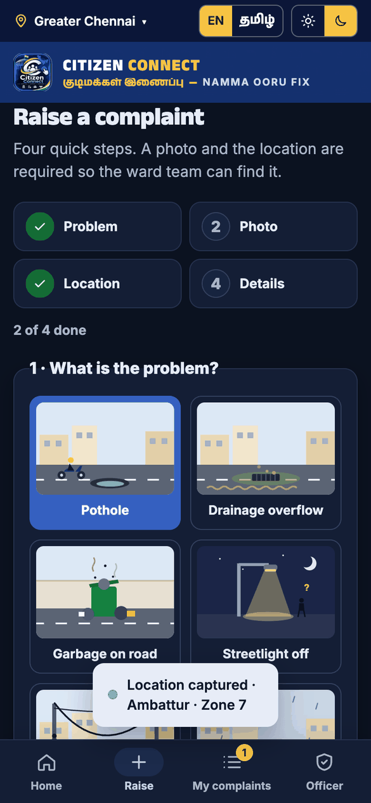
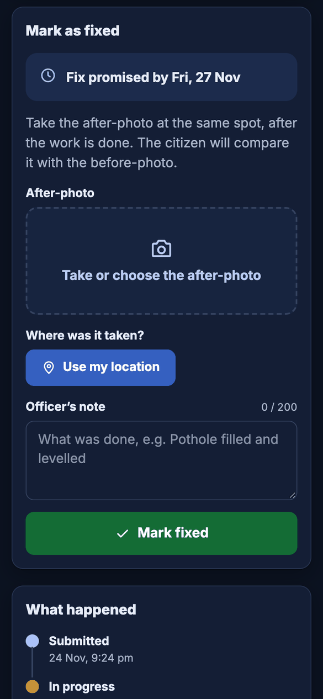
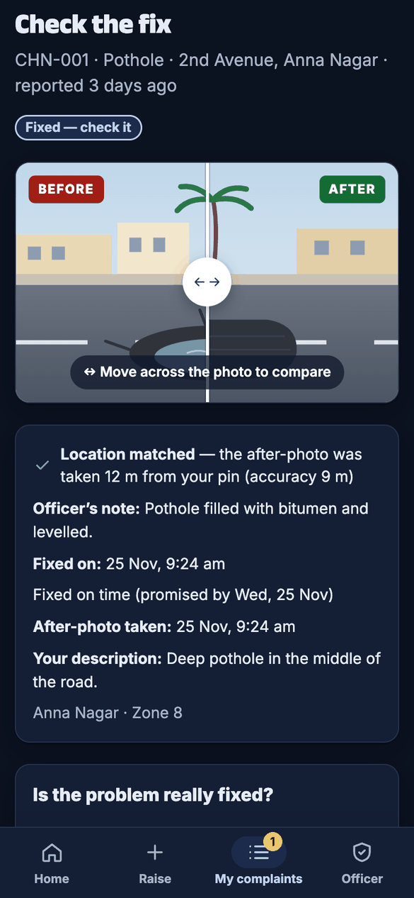
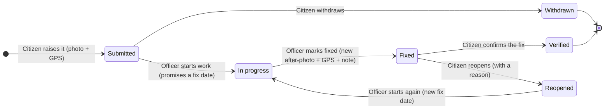

# Citizen Connect — Namma Ooru Fix

A civic-complaint web app for Chennai with **proof of fix**.

Most complaint systems let the department close a complaint by itself. In Citizen Connect:

1. A citizen raises a street problem with a **photo** and a **GPS location**.
2. The officer promises a **fix date**, and can only mark the complaint fixed with a **new after-photo taken at the spot**.
3. **Only the citizen** can close it, after comparing the before and after photos. If it isn't really fixed, they reopen it with a reason.

Plain HTML, CSS and JavaScript, with no framework and no build step. It works in English and Tamil, in light and dark themes, installs on a phone as an app (PWA), and works offline after the first visit.

> Student prototype by Class XII, Gandhiji Matriculation School, Avadi — Inter-School Hackathon 2026.
> Not an official Greater Chennai Corporation app.

<table>
  <tr>
    <td align="center"><br><sub>Home</sub></td>
    <td align="center"><br><sub>Raise a complaint</sub></td>
    <td align="center"><br><sub>Officer: mark fixed</sub></td>
    <td align="center"><br><sub>Citizen: check the fix</sub></td>
  </tr>
</table>

---

## Contents

- [The complaint loop](#the-complaint-loop)
- [Run it on your computer](#run-it-on-your-computer)
- [Tests](#tests)
- [Put it online and install it](#put-it-online-and-install-it)
- [Hackathon demo script](#hackathon-demo-script)
- [Folder map](#folder-map)
- [Data, storage and photos](#data-storage-and-photos)
- [Security and privacy](#security-and-privacy)
- [Limits and next steps](#limits-and-next-steps)

---

## The complaint loop



Every change goes through one file, [`js/rules.js`](js/rules.js), which decides **who** may make it and **what proof** it needs. Anything not listed there is refused.

| Status | Citizen sees | Officer sees |
|---|---|---|
| Submitted | "Waiting for an officer to start work" | **Start work**: must choose the date the fix will be done by |
| In progress | "Fix promised by Thu, 27 Nov", or red **Overdue** if the date passed | **Mark fixed** form, with a directions link to the spot |
| Fixed | **Check the fix**: before/after slider, distance from the pin, photo time, on time or late | "Waiting for citizen" |
| Reopened | "Waiting for the officer to start again" | Listed first, with the citizen's reason |
| Verified / Withdrawn | Closed | Closed |

### What the officer must provide to mark a complaint fixed

| Proof | Checked by |
|---|---|
| An after-photo | `rules.js` refuses the move without one |
| Taken **after** the complaint was raised (or after the last reopen) | The camera's EXIF date, or the file's time, is read before the photo is re-encoded. Older photos are refused. |
| GPS location at the spot | Must be inside Greater Chennai, with accuracy of ±150 m or better. The citizen sees the distance from their pin. |
| A note of what was done | 5–200 characters |

When a citizen reopens a complaint, the old after-photo stays in the timeline as evidence, and the officer has to post a new one.

---

## Run it on your computer

```bash
git clone https://github.com/sjaishree0502/citizen-connect.git
cd citizen-connect
python3 -m http.server 8080
```

Open <http://localhost:8080>. The camera, GPS and install only work on `localhost` or `https`, so don't open the files directly with `file://`.

---

## Tests

```bash
npm test               # 41 unit tests, no install needed (Node 18+)
npm install            # once, for the browser test
npm run test:e2e       # full loop in headless Chrome
```

- **Unit tests** (`tests/*.test.js`): every allowed and refused status change in `js/rules.js`, including the after-photo time rule and the fix date; every input check in `js/validate.js`; and the EXIF date reader in `js/photos.js`.
- **End-to-end test** (`tests/e2e/loop.e2e.mjs`): starts its own local server and drives Chrome with simulated GPS through raise → officer PIN → start work → blocked "Mark fixed" without a photo → old photo refused → fixed → reopened → overdue → fixed again → verified → erase. It checks the citizen and officer screens at every step and fails on any console error. It needs Google Chrome; set `CHROME_PATH` if Chrome is not in the default macOS location.

---

## Put it online and install it

The phone camera, GPS and "Install app" need `https`. GitHub Pages gives that for free.

1. In this repository: **Settings → Pages → Build and deployment → Deploy from a branch**, choose `main` and `/ (root)`, then **Save**.
   *GitHub Pages on a **private** repository needs a paid GitHub plan. On a free account, make the repository public first.*
2. After about a minute, open `https://sjaishree0502.github.io/citizen-connect/`.
3. Install it:
   - **Android (Chrome):** menu → **Install app**. Long-press the icon for "Raise a complaint" and "My complaints" shortcuts.
   - **iPhone (Safari):** Share → **Add to Home Screen**.
   - **Mac or PC (Chrome or Edge):** the install icon at the right end of the address bar.

**After changing any app file**, run `npm run build-sw` (or `python3 tools-build-sw.py`) before pushing. This updates the offline file list and its version, so installed phones pick up the new version.

---

## Hackathon demo script

Use **one phone, one browser** (not a private window) for the whole demo, and set the officer PIN beforehand.

| # | Who | Show |
|---|---|---|
| 1 | Citizen | Raise a complaint with a real photo and **Use my location**. |
| 2 | Officer | Open it, tap **Directions to the spot**, pick **In 3 days**, **Start work**. Point out that the citizen now sees the promised date. |
| 3 | Officer | Tap **Mark fixed** with no photo → blocked. Pick an old gallery photo → refused. |
| 4 | Officer | Take a fresh after-photo, **Use my location**, write a note, **Mark fixed**. |
| 5 | Citizen | **Check the fix**: drag the before/after slider, show "Location matched — 12 m from your pin". |
| 6 | Citizen | **No, reopen it** with a reason. The officer must fix it again with a new photo; the old one stays in the timeline. |
| 7 | Citizen | **Yes, it's fixed** → closed, with "Fixed on time" or "late". |
| 8 | Extras | Switch to தமிழ், switch the theme, turn Wi-Fi off and reload: it still opens. |

**Rehearse at the venue:** indoor GPS can be weak, and "Mark fixed" refuses accuracy worse than ±150 m. Stand near a window. The location must be inside Greater Chennai.

To start again: footer → **Erase data on this device** (tap twice). This deletes every complaint, photo and the officer PIN on that device.

---

## Folder map

| Path | What it does |
|---|---|
| `index.html` … `update.html` | One page per screen. Each loads one script from `js/pages/`. |
| `css/style.css` | Colours (light and dark), layout, components, animations, phone sizes. |
| `js/rules.js` | **Who can change a complaint to which status, and what proof it needs.** Pure functions, unit-tested. |
| `js/validate.js` | Every input check: photo type and size, location inside Chennai, area text, reason, note, fix date, PIN, ID format. |
| `js/store.js` | Saves complaints in `localStorage`. Pages never touch storage directly. |
| `js/photos.js` | Reads when a photo was taken, shrinks it, strips hidden data, and saves it in IndexedDB. |
| `js/data.js` | The 14 problem types, 15 Chennai zones, cities, pilot area, GPS accuracy limit. |
| `js/helpers.js` | Safe DOM building (text is never inserted as HTML), toasts, distance, dates. |
| `js/i18n.js`, `js/i18n-ta.js` | English and Tamil. **The Tamil is a draft: get it checked by our Tamil teacher.** |
| `js/layout.js` | Header, footer, phone tab bar, language and theme switches, city menu, officer session and PIN. |
| `js/ui.js` | Shared parts: status badges, complaint cards, fix-date lines, pager, before/after compare, timeline. |
| `js/pages/*.js` | One script per page: home, raise, my, verify (citizen); login, officer, update (officer). |
| `manifest.json`, `service-worker.js`, `img/icons/` | Install as an app (including an Android "maskable" icon) and work offline. |
| `tools-build-sw.py` | Regenerates `service-worker.js` with the current file list and version. |
| `tests/` | Unit tests and the end-to-end test. |
| `docs/screenshots/` | Images for this README (not part of the app). |

---

## Data, storage and photos

There is **no server**. Everything stays in the browser on the device.

| Data | Stored in | Size |
|---|---|---|
| Complaints | `localStorage` · `cc.complaints.v2` | ~1 KB each (~1.5 KB after a reopen) |
| Photos | IndexedDB · database `citizen-connect` | 45–200 KB each (see below) |
| Officer PIN | `localStorage` · `cc.officerPin.v1` | Salted SHA-256 hash only |
| Settings (language, theme, list/grid, tour seen) | `localStorage` · `cc.prefs.v1` | Tiny |
| Officer sign-in | `sessionStorage` | Ends when the tab closes |

### How photos are optimized

Every photo, from the citizen or the officer, goes through `preparePhoto()` in `js/photos.js`:

1. **Checked:** JPG, PNG or WebP only, under 15 MB, and it must decode as a real picture at least 200 × 200 px.
2. **Time read:** the camera's EXIF "date taken" and the file time, for the after-photo rule.
3. **Shrunk:** longest side 1200 px, which is still sharp enough to compare before and after.
4. **Re-encoded as JPEG at quality 0.8.** This also **removes hidden data** such as the camera's GPS tag, so a citizen's home location isn't leaked through the photo.
5. **Saved as a Blob in IndexedDB.** Complaints store only a reference like `idb:p-…`.

Measured in Chrome with 12-megapixel (4032 × 3024) phone photos:

| Photo | Original | Stored | Saving |
|---|---|---|---|
| Smooth scene (sky, walls) | 1.1 MB | **44 KB** | 96% |
| Detailed scene (road texture, grain) — worst case | 7.1 MB | **193 KB** | 97% |

WebP was also tested. It was smaller for smooth scenes but **larger** for detailed street photos, and iPhone Safari can't produce WebP from a web page, so JPEG is used everywhere.

### How much fits

| Limit | Roughly |
|---|---|
| `localStorage` (~5 MB per site) | 3,000–5,000 complaint records |
| IndexedDB (the browser lets a site use a large share of free disk, usually several GB on a phone) | Each complaint uses 2 photos ≈ 0.1–0.4 MB, so even **1 GB holds 2,500–10,000 complaints** |

- The first time a photo is saved, the app asks the browser for **persistent storage** (`navigator.storage.persist()`), so the browser doesn't clear the data when the phone runs low on space.
- **iPhone Safari** may clear a website's data after 7 days without a visit. **Installing to the home screen** avoids that.
- If the device is full, the user sees "This phone's storage is full" and nothing half-saved is left behind (the photo is removed if its complaint could not be saved).

---

## Security and privacy

- A strict **Content-Security-Policy** on every page: only our own scripts, styles, fonts and images, with no inline scripts.
- Anything a user types is shown as plain text (`textContent`), never as HTML. `<` and `>` are refused in the area field.
- Uploads must decode as real pictures. Re-encoding strips EXIF data, including the GPS tag.
- Broken or hand-edited storage is ignored safely, so the app doesn't crash.
- The officer PIN is chosen on first use and stored only as a salted SHA-256 hash. Five wrong tries pause sign-in for 30 seconds. **This guards a shared device only; it is not real staff security.**
- Photo-time and GPS checks run in the browser, so a determined person could fake them. A real version would check them on a server.

---

## Limits and next steps

| Today (prototype) | A real version would |
|---|---|
| Data lives on one device, so citizen and officer use the same phone | Keep the same `rules.js` and save to a Corporation server, so each person uses their own phone |
| Officer PIN per device | Use the Corporation's staff login and assign complaints by ward |
| A complaint marked fixed waits for the citizen forever | Auto-close after a few days without a reply, and escalate overdue fixes |
| No notifications | Send SMS or push messages when the status changes |
| Tamil text is a draft | Have the Tamil teacher check it |
